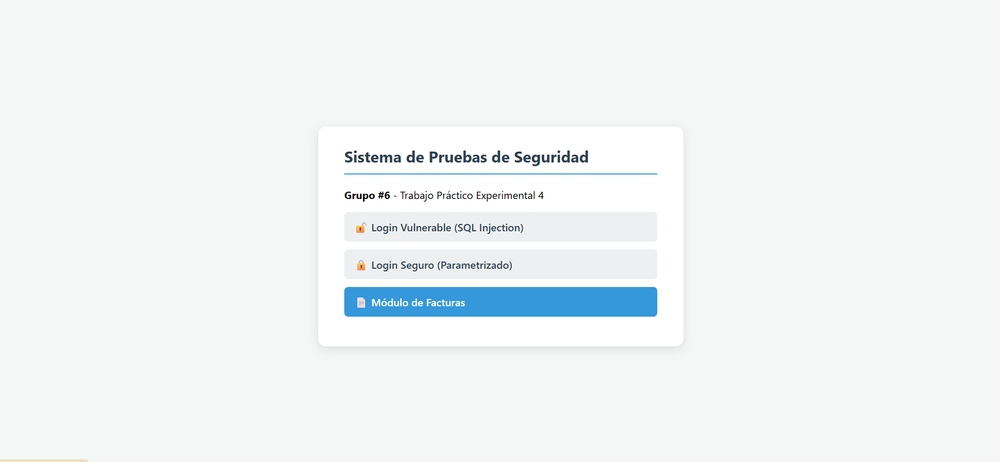
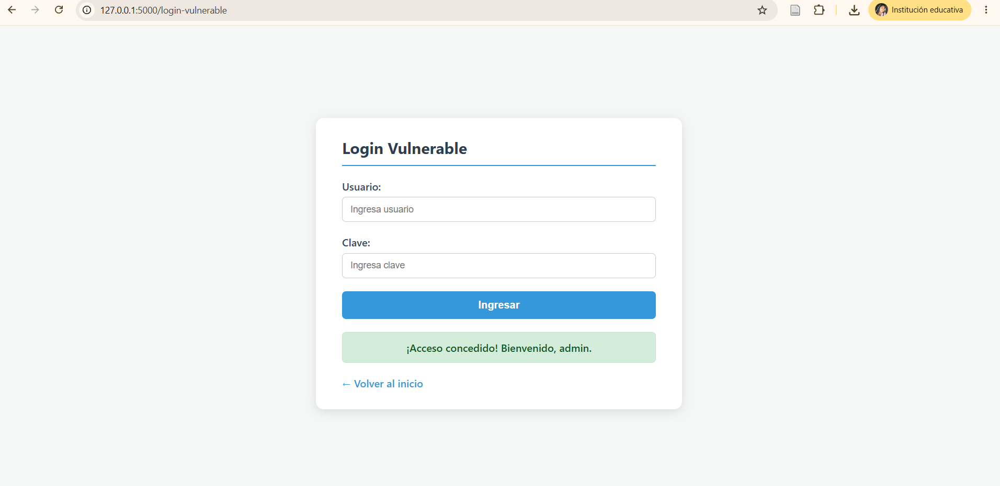
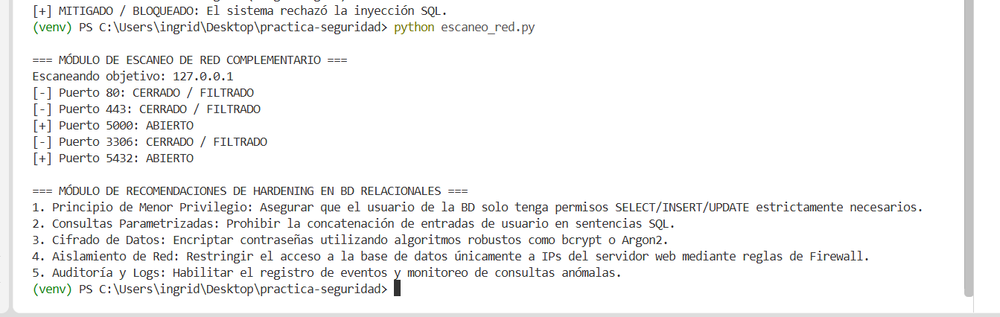
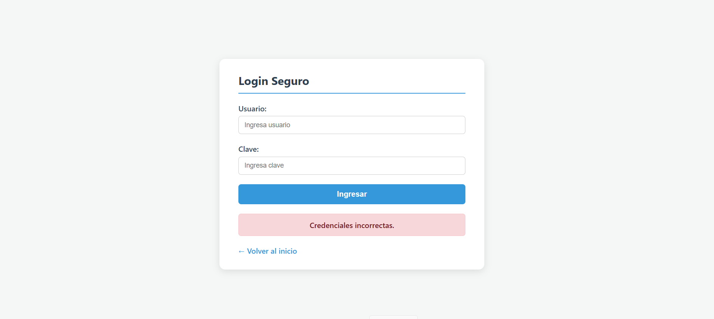
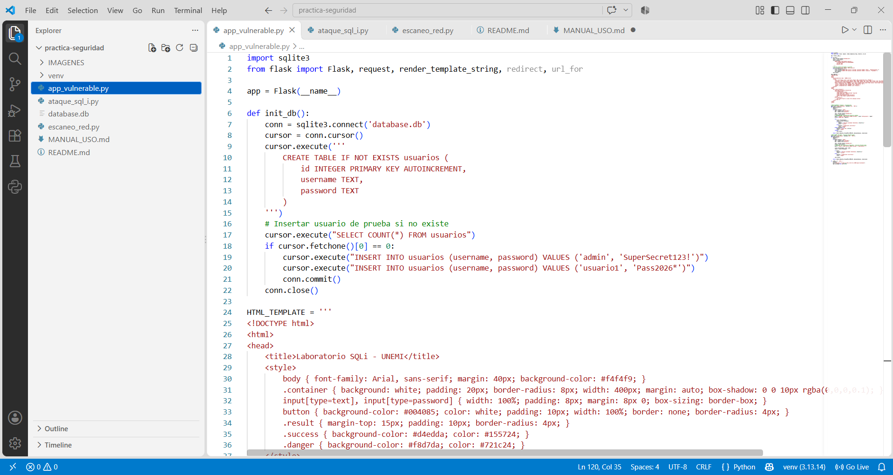
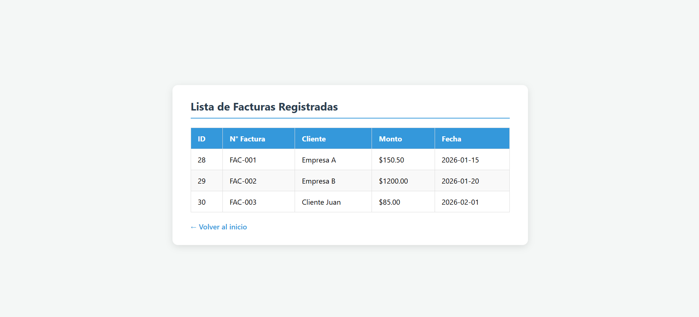

# 🛡️ Proyecto de Seguridad Informática: SQL Injection, Escaneo de Red y Hardening

**Universidad:** Universidad Estatal de Milagro (UNEMI)  
**Asignatura:** Seguridad Informática  
**Práctica:** Trabajo Práctico Experimental 4  
**Docente:** Ing. Alex Armando Ávila Coello  
**Carrera:** Tecnologías de la Información (Modalidad en Línea)  
**Autor:** Grupo 6  
**Año:** 2026

## 📌 Descripción del proyecto

Este proyecto académico presenta una aplicación local desarrollada con Python y Flask para estudiar la vulnerabilidad **SQL Injection** y comparar un inicio de sesión vulnerable con uno que utiliza consultas SQL parametrizadas. Incluye, además, un módulo de consulta de facturas almacenadas en SQLite, un script de prueba HTTP y un módulo complementario de escaneo de puertos TCP y recomendaciones de hardening.

> **Aviso de seguridad:** utilice esta práctica únicamente en su propio equipo, una máquina virtual o un entorno para el que tenga autorización. La aplicación vulnerable es didáctica; no debe exponerse a Internet ni utilizarse con datos reales.

## 📚 Contenido

- [Módulos del proyecto](#-módulos-del-proyecto)
- [Requisitos previos](#-requisitos-previos)
- [Instalación y configuración](#-instalación-y-configuración)
- [Ejecución](#-ejecución)
- [Credenciales de prueba](#-credenciales-de-prueba)
- [Capturas de pantalla](#-capturas-de-pantalla)
- [Estructura del proyecto](#-estructura-del-proyecto)
- [Manual detallado](#-manual-detallado)

## 🧩 Módulos del proyecto

| Archivo o módulo | Descripción |
|---|---|
| `app_vulnerable.py` | Aplicación Flask con las rutas de inicio de sesión vulnerable, inicio de sesión seguro y consulta de facturas. Inicializa la base de datos SQLite. |
| `ataque_sql_i.py` | Script que envía solicitudes HTTP a las rutas de autenticación para comparar sus respuestas. |
| `escaneo_red.py` | Comprueba puertos TCP seleccionados en el equipo local y muestra recomendaciones de hardening para bases de datos. |
| `database.db` | Base de datos SQLite con tablas y registros de prueba. |
| `capturas/` | Evidencias gráficas del desarrollo y ejecución de la práctica. |

## 💻 Requisitos previos

Antes de ejecutar el proyecto, se recomienda tener instalado:

- Python 3.x.
- Git (si se va a clonar el repositorio).
- Visual Studio Code u otro editor de código.
- Un navegador web actualizado.

Verifique Python y Git desde una terminal:

```bash
python --version
git --version
```

En Windows también puede comprobar Python con:

```bash
py --version
```

## ⚙️ Instalación y configuración

### 1. Clonar el repositorio

```bash
git clone https://github.com/ichacinr-blip/Grupo-6practica-seguridad-.git
cd Grupo-6practica-seguridad-
```

Si ya descargó el proyecto como ZIP, extráigalo y abra la carpeta desde Visual Studio Code. En ese caso, no necesita ejecutar `git clone` ni `cd` si la terminal ya está ubicada en la carpeta del proyecto.

### 2. Crear el entorno virtual

```bash
python -m venv venv
```

### 3. Activar el entorno virtual en Windows

**PowerShell:**

```powershell
.\venv\Scripts\Activate.ps1
```

Si PowerShell impide la activación por la política de ejecución, permita scripts solo en la terminal actual y vuelva a activar:

```powershell
Set-ExecutionPolicy -Scope Process -ExecutionPolicy Bypass
.\venv\Scripts\Activate.ps1
```

**CMD:**

```cmd
venv\Scripts\activate.bat
```

Cuando el entorno esté activo, verá `(venv)` al inicio de la línea de comandos.

### 4. Instalar las dependencias

```bash
python -m pip install --upgrade pip
python -m pip install flask requests
```

## ▶️ Ejecución

### 1. Iniciar la aplicación web

Con el entorno virtual activado, ejecute:

```bash
python app_vulnerable.py
```

La aplicación se ejecuta localmente en el puerto 5000. Mantenga abierta esta terminal mientras realiza las pruebas.

### 2. Abrir la aplicación

En el navegador, visite:

```text
http://127.0.0.1:5000
```

En la página principal encontrará estas opciones:

- **Login Vulnerable (SQLi):** formulario de autenticación cuya consulta SQL concatena los valores recibidos.
- **Login Seguro:** formulario que utiliza parámetros SQL (`?`) para separar los datos de entrada de la consulta.
- **Módulo de Facturas:** muestra registros de ejemplo almacenados en SQLite.

### 3. Ejecutar el script de prueba SQL Injection

Con el servidor Flask activo, abra una segunda terminal, active el entorno virtual si hace falta y ejecute:

```bash
python ataque_sql_i.py
```

El script realiza solicitudes a las rutas `/login-vulnerable` y `/login-seguro` del servidor local y presenta los resultados en la terminal.

### 4. Ejecutar el escaneo de puertos y las recomendaciones

En otra terminal, ejecute:

```bash
python escaneo_red.py
```

El módulo comprueba los puertos TCP `80`, `443`, `5000`, `3306` y `5432` de `127.0.0.1`. Después imprime cinco recomendaciones de hardening. El resultado corresponde únicamente al equipo local donde se ejecuta el programa.

## 🔐 Credenciales de prueba

La aplicación inicializa registros de ejemplo en la base de datos si las tablas están vacías. Las credenciales incluidas en el código son:

| Usuario | Clave |
|---|---|
| `admin` | `admin123` |
| `user1` | `clave123` |

Son credenciales exclusivamente académicas. No las reutilice en sistemas reales.

## 🖼️ Capturas de pantalla

Las siguientes evidencias se muestran desde la carpeta `capturas`. Para que aparezcan en GitHub, conserve esa carpeta en el mismo nivel que este archivo `README.md` y respete exactamente los nombres de las imágenes.

### 1. Menú inicial de la aplicación



### 2. Ingreso de datos



### 3. Ejecución de pruebas y escaneo



### 4. Resumen de resultados



### 5. Código fuente en Visual Studio Code



### 6. Módulo de facturas



> **Nota:** agregue el archivo `06_facturas.png` dentro de `capturas/`. La imagen debe llamarse exactamente así para que GitHub pueda mostrarla.

## 📁 Estructura del proyecto

```text
Grupo-6practica-seguridad-\
│
├── capturas/
│   ├── 01_menu_inicial.png
│   ├── 02_ingreso_datos.png
│   ├── 03_escaneo.png
│   ├── 04_resumen.png
│   ├── 05_codigo.png
│   └── 06_facturas.png
│
├── app_vulnerable.py
├── ataque_sql_i.py
├── escaneo_red.py
├── database.db
├── MANUAL_USO.md
└── README.md
```

## 📖 Manual detallado

Para consultar las instrucciones ampliadas, con el procedimiento paso a paso, visite el archivo **[MANUAL_USO.md](MANUAL_USO.md)**.

## 🎯 Objetivo académico

Demostrar, en un entorno local y controlado, la diferencia entre una consulta SQL vulnerable construida mediante concatenación y una consulta parametrizada, así como practicar la ejecución de solicitudes HTTP, la consulta de datos en SQLite, la identificación básica de puertos TCP y la revisión de medidas de hardening.
